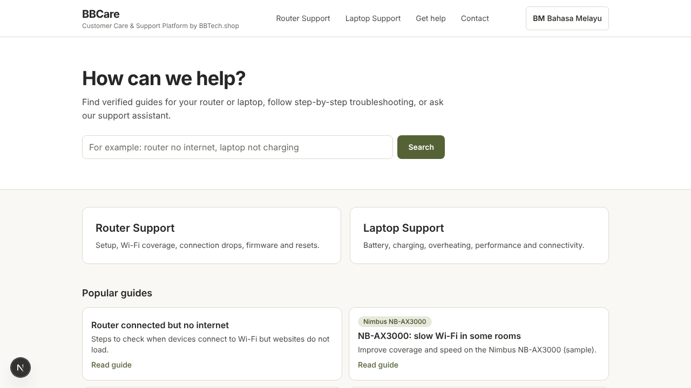

# BBCare

**Customer Care & Support Platform by BBTech.shop**

BBCare helps BBTech.shop customers in Malaysia troubleshoot routers and laptops in English and Malay. It offers verified guides, step-by-step troubleshooting, a support assistant that works without AI (and can use the owner's local AI once approved), verified product recommendations with Shopee referral links, human escalation, and privacy-conscious first-party analytics.



## What is in this repository

| Path | Contents |
|---|---|
| `apps/web` | Next.js 16 app: public site (`/en`, `/ms`), support assistant, admin console (`/admin`), API |
| `apps/worker` | Background jobs: analytics rollups, retention, embeddings (flag-gated), listing link checks |
| `packages/core` | Domain logic: Malay/English normalization, scrubbing, crypto/TOTP, RBAC, workflow, analytics schemas |
| `packages/db` | SQL migrations, migration runner, synthetic seed, search and repositories |
| `packages/ai` | AI provider interface, Flask adapter (private network only), mock test double, answer validation |
| `evals` | Bilingual evaluation dataset and runner |
| `infra` | Dockerfile/compose, Nginx templates, backup, restore, deploy, rollback, read-only server audit |
| `docs` | Specification (`docs/project`), architecture, decisions, runbooks, status and blockers |

## Status
See `docs/status/progress.md` (what is done and verified) and `docs/status/blockers.md` (what needs the owner).

## Development (cloud session or any Linux/macOS machine)
Requirements: Node 22, pnpm 10, PostgreSQL 16 with `pgvector`, `pg_trgm`, `unaccent`.

```bash
pnpm install
cp .env.example .env            # fill in local values; database name must end in _dev
ln -s ../../.env apps/web/.env  # Next.js reads env from the app folder
pnpm db:migrate
pnpm db:seed                    # synthetic data; credentials in packages/db/.seed-credentials.txt
pnpm dev                        # http://localhost:3000
pnpm worker                     # optional background jobs
```

Staff sign in at `/admin/login` and must enrol an authenticator app on first sign-in.

## Checks
```bash
pnpm -r typecheck
pnpm --filter @bbcare/web lint
pnpm --filter @bbcare/core --filter @bbcare/ai --filter @bbcare/web test     # unit tests
DATABASE_URL_TEST=postgres://.../bbcare_test pnpm --filter @bbcare/db test   # integration tests (resets the _test database)
pnpm --filter @bbcare/evals eval:retrieval                                   # retrieval evaluation gate
pnpm --filter @bbcare/web test:e2e                                           # Playwright: desktop, Android, iPhone, iPad
```
GitHub Actions runs all of these on every push (`.github/workflows/ci.yml`).

## Deployment
Container image plus Docker Compose behind Nginx or a Cloudflare Tunnel. See `docs/runbooks/deploy.md`, `docs/deployment/preview-and-staging.md`. Production deployment, production migrations, DNS changes and enabling customer-facing AI require the owner's explicit approval.

## AI
AI answers are **off by default**. The site is fully usable in search-first mode. Integration with the owner's existing Flask AI service is described in `docs/integration/flask-ai-service.md`. No paid hosted AI is used.
